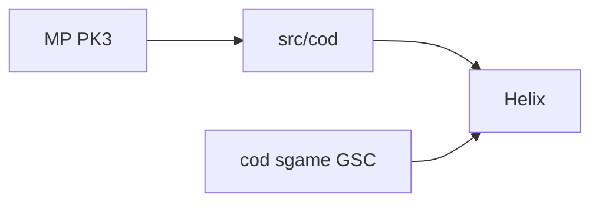

# CoD1 plugin: funkcionális futtatás

A munka a moduláris pluginban történik: [src/cod](src/cod). A `src/cod2003` érintetlen. PunkBuster kimarad. A közös asset (xmodel, textúra, shader, wav) elérhető marad, mert az MP pályák ezekre hivatkoznak. Ami szivárog, az a belépési pont: SP pálya, SP menü, SP level script, SP soundalias.

A Helix ([idTech3-4/src](c:\Users\tothd\Desktop\idTech3-4\src)) csak ott bővül, ahol a plugin nem tud játékot futtatni: világshader alfa, fegyvertömb, loading screen, és a GSC-hez szükséges szerverhorgok. A CoD GSC VM a Helix-Publicba kerül (sgame), nem a MIT motorba. A többi motorhiány a [docs/COD1_HELIX_BACKLOG.md](c:\Users\tothd\Desktop\idTech3-4\docs\COD1_HELIX_BACKLOG.md) fájlba megy. A [COD2003_RECOMMENDATIONS.md](c:\Users\tothd\Desktop\idTech3-4\docs\COD2003_RECOMMENDATIONS.md) collision/pmove javításait nem ismételjük és nem írjuk újra.

## MP hatókör

A [bsp/names.c](src/cod/bsp/names.c) `bsp_hxmap_alias` ma minden `.bsp`-t pályának hirdet, az SP `maps/<név>.bsp`-t is. A [plugin.c](src/cod/plugin.c) `note_map_body` a `maps/mp/<map>.gsc` után visszaesik a `maps/<map>.gsc` SP scriptre. A `bsp_candidate_paths` nem `maps/mp/` kérésnél szintén megnyitja az SP bsp-t.

- Pályalista és `.hxmap` alias: csak `maps/mp/*.bsp`. Prefab továbbra sem pálya.
- GSC olvasás: csak `maps/mp/` és `maps/mp/gametypes/`. SP `maps/<map>.gsc` nincs.
- Menü: csak `ui_mp/`. Az `ui/` SP menü ne töltődjön be és ne írja felül az MP menüt.
- Hang: a motor minden `soundaliases/*.csv`-t beolvas. Az SP-only táblát a plugin `contains`/`read` ne adja ki. A közös wav marad. A menüzene ne egy kitalált `sound/music/bgm.mp3` legyen: az `ui_mp` menü `play` / music hívásából jön. Ha a motor `music/bgm` néven indít zenét, erre a névre az MP alias kötődik.

## 1. Anyagok, alfa, caulk, víz

A shader ma egy név és egy kép: [shader/read.h](src/cod/shader/read.h). Az első kép gyakran a `qer_editorimage`, a valódi `map` ezután elveszik.

- A parser gyűjtse a `surfaceparm`, `blendFunc`, `alphaFunc`, `cull`, `sort`, `tcMod` kulcsokat. Albedo a játékbeli `map` / `clampmap`, nem az editorimage.
- Emisszió [shader/helix.c](src/cod/shader/helix.c): `twoSided`, `blend alpha`, `alphaTest <küszöb>` (`GE128` / `GT0`).
- `surfaceparm` `nodraw`, `caulk`, `hint`, `skip`, `clusterportal`, `areaportal`: a felület ne kapjon látható anyagot. A BSP névszűrő ([bsp/helix.c](src/cod/bsp/helix.c) ~466) ehhez a surfaceparmhez igazodik.
- Víz: a helyes diffúz stage pluginban javítható. A `tcMod` scroll a backlog, amíg a motornak nincs UV-animációja.

Motor: a material kap `alpha_test` küszöböt. A világshader mindkét backendben ma csak RGB-t olvas ([d3d12_backend.cpp](c:\Users\tothd\Desktop\idTech3-4\src\gpu\d3d12_backend.cpp) ~288, [gl_backend.cpp](c:\Users\tothd\Desktop\idTech3-4\src\gpu\gl_backend.cpp) ~587). Opaque úton `discard`, ha az alfa a küszöb alatt van. `blend alpha` külön áttetsző pass, mélységírás nélkül. Levél, kerítés, kép, víz széle ettől kivágott. A lombozat ütközése `contents nonsolid` és a clipmap meglévő névszűrője ([hxmap_loader.cpp](c:\Users\tothd\Desktop\idTech3-4\src\map\hxmap_loader.cpp) ~816).

## 2. Xmodel

[xmodel/read.c](src/cod/xmodel/read.c) egy LOD-ot, egy anyagot és v14-nél csak eltolást olvas. A kéz és a tár ezért rossz helyen van; a viewmodel tengelye nem a Helix +Z előre / +Y felfelé bázisa ([viewmodel_transform](c:\Users\tothd\Desktop\idTech3-4\src\render\render_world.cpp)).

- Valós `viewmodel_bar` / `weapon_bar` binárison a 19 bájtos csontrekord (parent, forgás, eltolás), majd alkalmazás a rigid submeshekre. A riggelt mesh bind pose marad. Az xanim lejátszás a backlog.
- Felületenkénti `usemtl`. LOD: a 0 távolságú felület.
- `viewmodel_*` OBJ a Helix view bázisba forgatva, a pluginban.
- Pályára tett kép: a BSP ne dobja el az összes `decal` mesht (~477). A lövedéknyom-decal továbbra is kiesik.
- Kitört fal darabjai: a `_d` modellszűrő (~287) ne dobja el a pályára helyezett törmeléket. Az ép fal, ami a lyukat betömnné, submodel ecset, nem ez a mesh. A törmelék mesh-ütközést kap, nem egy tömör befoglaló dobozt.
- Bokor/fa: alfa a shaderből, ütközés `nonsolid`.

## 3. Ütközés — harbor kitört fal

A palló járható. Nem ez a hiba, és nem kerül a „járhatóvá tenni” listára.

A tűzoltóságnál két külön nyílás van:

- A palló mellett a fal alsó része ki van törve. CoD-ban ezen állva be lehet menni. Nálunk a nyílás tömör.
- Ahol ténylegesen az ablak van kitörve, CoD-ban guggolva lehet közlekedni. Ez a kívánt magasság: a nyílást nem tágítjuk álló méretűre. Nálunk ez az átjáró is bizonytalan vagy zárt.
- A kitört daraboknak CoD-ban van ütközésük. Nálunk a solid mesh csak akkor ütközik, ha egyáltalán nincs ecset; ha van, csak a terrain-kulcsszavas mesh solid ([bsp/helix.c](src/cod/bsp/helix.c) ~508). A törmelékháromszög ezért átjárható, miközben egy ecset vagy annak AABB-je betömi a lyukat.

Javítás a pluginban:

- Ecset: minden brush side síkja kimegy, a Helix a síkok metszetét használja. Az első hat oldal távolságából képzett AABB (~380–420) a ferde és az ablak körüli ecsetet a lyukba növeli. A világecset szelete `first_brush` + `num_brushes`, nem a lump elejétől számolt darabszám, ha a kettő eltér. A submodel (ép ajtó, ép fal `script_brushmodel`) nincs a világütközésben.
- `playerclip` → `contents playerclip`. Az ablakpárkány clipje marad, ezért a tényleges ablak guggolós. `weapclip` nem fal. `caulk` ecset solid és láthatatlan.
- Törmelék: a pályán álló, nem-lomb `misc_model` és a solid contentű, nem-tool soup ütközik akkor is, ha már van más ecset. Nem egy második terep-prizma a járófelületen: ahol ecset fedi a talajt, a talajmesh `nonsolid` marad, hogy a ferde talaj ne lőjön ki. A patch/terep ecset nélkül solid mesh marad.
- Álló hull 56 (`-24..32`) a CoD 70-nel szemben. A lyuk betömése ecsethiba, nem hullméret. A `pmove` nem kerül elő, amíg a nyílás a síkokkal ki nem tisztul.

Trigger, hint, portal, areaportal láthatatlan marad. A futásidejű trigger és a PVS a backlog. A GSC a gametype szabályt futtatja; a hint/portal vizuális eszköz, nem a játékmód.

## 4. Hang

A néma hang először hatókör: SP csv és a `bgm.mp3` találgatás nem MP menüzene. Utána:

- Az MP `ui_mp` és a `maps/mp` script által hivatkozott aliasok kerülnek a Helix `sound { file }` szövegbe ([sound/helix.c](src/cod/sound/helix.c)).
- A `SoundWorld::play` az első azonos nevű shadert veszi. A motor előbb procedurális `weapon/mg` hangot regisztrál ([modules.cpp](c:\Users\tothd\Desktop\idTech3-4\src\engine\modules.cpp) ~654). A fájlos alias legyen az, amelyik megszólal.
- `ambient` / `music` csatorna nagy távolságú looping. A menü `onOpen` `play` akciója akkor is megmarad, ha az item ownerdraw.

## 5. Menü és loading screen

A főmenü megvan, az almenük nem ürülnek ki és nem cserélődnek egy rövid Helix-héjra. Az ownerdraw, feeder, multi és bind itemek ma kiesnek ([ui/helix.c](src/cod/ui/helix.c)); ezek a szerverindító, a pályalista, a csapat- és a fegyverválasztó. Megmaradnak, és a Helix tudása a megfelelő kontrollra kerül:

- Szerverindító: gametype a GSC-ből (`dm`, `tdm`, `sd`, `re`, `bel`), pályalista csak `maps/mp`, és a kiválasztott pálya preview képe (`levelshots/`, illetve a map script `layoutimage` / loadscreen képe). A Helix UI a kép itemet már megjeleníti ([ui.cpp](c:\Users\tothd\Desktop\idTech3-4\src\ui\ui.cpp)); a panel a CoD menü helyén ezt a képet kapja.
- Grafika, hang, irányítás: a CoD options itemjei a meglévő Helix cvarokra kötve (`r_width`, `r_height`, `r_fullscreen`, `s_volume`, `s_musicvolume`, `sensitivity`, bind).
- Csapatválasztó: allies / axis, a map GSC `game["allies"]` és `game["axis"]` felirataival.

Loading screen a Helixben, a `load_map` alatt: szöveg, kép, vagy a kettő, plusz egy loading bar a betöltés szakaszai szerint (pálya, modellek, hang, ütközés). A kép és a felirat a pluginból jön (`levelshots/<map>`, loadscreen). A motorban erre ma nincs felület.

## 6. Fegyverek és GSC

A két beégetett slot (MG/SG, [pmove.hpp](c:\Users\tothd\Desktop\idTech3-4\include\helix\game\pmove.hpp), `ammo_mg` / `ammo_sg` a [snapshot.hpp](c:\Users\tothd\Desktop\idTech3-4\include\helix\net\snapshot.hpp)-ben, `mesh_viewmodel(1|2)`) nem elég. A Helix fegyvertömböt kap: `WeaponDef` tömb, játékosonként lőszer és tár indexelve, viewmodel és world model ugyanazon az indexen. A fix `viewmodel_BAR` / `viewmodel_m1garand` alias ([xmodel/helix.c](src/cod/xmodel/helix.c)) megszűnik. A CoD1 MP fegyvernevek (`m1garand_mp`, `kar98k_mp`, `bar_mp`, …) ehhez a tömbhöz kötődnek, viewmodel + world xmodel + a hangalias.

A játéktípusok a GSC-ben vannak (`maps/mp/<map>.gsc` `main`, `maps/mp/gametypes/*.gsc`). Regexes `level.*` kiolvasás nem futtatja őket. A VM a Helix-Public `sgame` modulja, CoD-specifikus, és ezeket futtatja:

- script szál, `wait` / `endon` / `notify` / `waittill`, `level` / `game` / `self`
- map `main` és a kiválasztott gametype (`dm`, `tdm`, `sd`, `re`, `bel`)
- a gametype által hívott fegyver- és spawn-műveletek: give, take, switch, spawn origin, csapat, pont, `ambientPlay`

A Helix sgame import ([iserver_game.h](c:\Users\tothd\Desktop\idTech3-4\include\helix\game\iserver_game.h)) ehhez kap horgot: fegyver adás/elvétel a tömbből, csapat, pontszám. Ami a VM-ben CoD-only (a nyelv), az a public repóban marad. Ami általános játékállapot (fegyvertömb, loading, csapat), az a motorba megy, és a backlog „ebben a körben bekerült” szakaszába.

Nem lesz xanim csontváz, PVS, `tcMod`, és mozgó `script_brushmodel` ebben a körben. Ezek a backlog másik szakasza.

## 7. Dokumentum és tesztek

A backlog az implementációval együtt készül. Két szakasz: ami a motorba került (alfa, hang-precedencia, fegyvertömb, loading screen, sgame horgok), és ami nem (xanim, tag, `tcMod`, PVS, mozgó ajtó, lightmap, hull-cvar).

Tesztek [tests/hxfs_cod_test.c](tests/hxfs_cod_test.c): SP bsp nincs a listán, SP `maps/*.gsc` nem esik vissza, editorimage helyett `map`, `alphaTest`, caulk surfaceparm, síkos ecset nem tölti a lyukat, törmelékmodell megmarad, ablak-clip `playerclip`, MP menü preview útvonal, gametype script belépési pont. `COD_CACHE_REV` nő a [cache.c](src/cod/cache.c)-ben.

Ellenőrzés, ha a `Main/` elérhető: `mp_harbor` (palló marad járható, alsó kitört fal állva, ablak guggolva, törmelék ütközik, víz, kép) és egy bokros MP pálya. Menü: szerverindító preview, loading bar, dm és tdm indítás a GSC-ből, fegyverlista nem a fix BAR pár.
